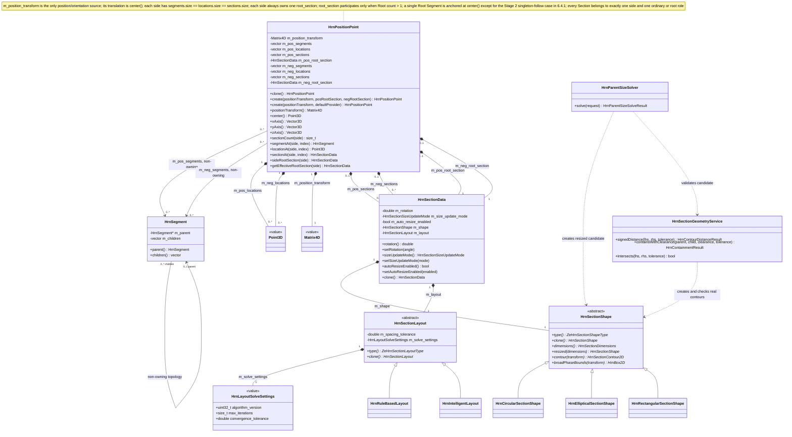

# 位置点分侧截面数据结构设计

## 1. 文档状态

- 状态：评审通过
- 日期：2026-11-13
- 评审通过日期：2026-11-16
- 范围：仅使用普通 C++ Class 讨论单个 Position Point 正、负两侧的截面数据结构，以及保持三份平行容器一致所需的运行时契约
- 不包含：面积计算、排布算法细节、沿路径姿态连续性和三维实体生成

## 2. 设计意图

位置点两侧分别通过 Segment 容器和 Location 容器记录穿过位置点的 Segment 及其截面计算结果：

```cpp
std::vector<HrnSegment*> m_segments;
std::vector<Point3D> m_locations;
```

正、负两侧各有一组独立容器。Segment 容器不只是截面成员集合，还提供线束拓扑身份。两侧分别包含本侧全部层级的 Segment，Segment 的父子层级由 `HrnSegment` 对象表达。

本设计在不改变上述职责的前提下，为两侧分别增加与 Segment 容器同序的 Section 数据容器，使每个“Position Point × Side × Segment”具有独立、可扩展的截面定义。正、负两侧即使存在既有 Segment 对应关系，也允许使用不同的截面形状、尺寸和旋转。

Position Point 每侧始终持有一个不对应具体 Segment 的 Root Section。只有当本侧存在多个 Root Segment 时，Root Section 才作为这些 Root Segment 的共同排布边界参与计算；0 个或 1 个 Root Segment 时保留其参数但不参与本次计算。

## 3. 现有设计约束

### 3.1 Position Point 是截面位置载体

Position Point 保存唯一的三维齐次刚体变换矩阵，用其平移分量描述公共中心位置、用正交旋转分量描述截面平面的 X/Y 方向和法向 Z，并区分正、负方向。每侧的 Location 容器保存截面计算完成后各 Segment 的三维中心坐标。

### 3.2 Segment 是拓扑和层级身份

Segment 容器及 Segment 自身的父子关系是线束拓扑的权威数据。Section 数据不得：

- 替换正、负两侧的 Segment 拓扑职责；
- 在 Section 条目中重复保存 Segment 引用；
- 另建一棵与 Segment 父子关系重复的 Section 树；
- 通过正负容器下标推断两侧 Segment 的对应关系。

### 3.3 两侧数据独立、计算统一提交

正负两侧的 Segment 数量、层级和截面定义都可能不同。有效的不变量仅存在于单侧内部：

```text
pos_seg[i] <-> pos_loc[i] <-> pos_section[i]
neg_seg[j] <-> neg_loc[j] <-> neg_section[j]
```

不要求：

```text
size(pos_seg) == size(neg_seg)
pos_seg[i] 与 neg_seg[i] 存在任何关系
pos_section[i] 与 neg_section[i] 具有相同形状或尺寸
```

两侧 Segment 之间既有的一对一、一对多或多对一关系不属于本设计的数据结构范围。普通对应关系本身不得自动推导位置相等；只有既有关系中被明确标记为“同位置约束”的 Segment 对，才由上层作为求解硬约束输入，要求它们在 Position Point 处具有相同二维中心坐标，进而得到相同三维 Location。未标记的关系不施加中心相等约束。该约束不能改变分侧 Section 数据的独立所有权，但约束关联的两侧 Section 及其祖先依赖必须进入同一个跨侧联合求解组。任一侧参数变化仍按整点事务重新计算正、负两侧并统一提交。

## 4. 方案比较

### 4.1 方案 A：继续增加多个基本类型平行容器

为形状类型、半径、宽度、高度和旋转分别增加容器。

优点：

- 与现有容器形式表面上接近；
- 对简单圆形截面实现成本低。

缺点：

- 容器数量随参数增加而膨胀；
- 不同形状的大量字段无效；
- 所有容器都必须保持等长同序，极易产生错位；
- 无法自然支持不同形状的参数扩展。

结论：不采用。

### 4.2 方案 B：统一固定结构或联合体

用形状枚举配合固定字段或联合体保存不同形状参数。

优点：

- 单个 Section 条目可以包含完整数据；
- 常见字段访问直接。

缺点：

- 固定字段会产生无效参数组合；
- 每增加一种形状或扩展形状参数，都需要修改公共结构。

结论：不采用。

### 4.3 方案 C：Section 组合多态 Shape 与 Layout

Section 保存公共数据，并组合一个多态 Shape 和一个多态 Layout。不同 Shape 派生类保存各自可扩展的边界参数；Layout 描述“本 Section 内直接子成员”的排布策略，首版提供基于确定性规则的紧密排布和基于启发式算法的智能紧凑排布。Position Point 两侧各增加一个与原 Segment 容器同序的 Section 对象容器。

优点：

- 各 Shape 只保存自身有效参数；
- 形状参数可独立演进；
- 新增形状不改变 Position Point 的字段布局；
- 外边界与排布策略解耦，避免产生“矩形分层 Section”“椭圆分层 Section”等组合型派生类；
- Section 公共属性只定义一次；
- 不重复 Segment 拓扑。

代价：

- 普通 C++ 对象需要明确 Shape、Layout 的所有权和深拷贝；
- 容器增删必须与 Segment、Location 容器原子同步；
- 形状或排布类型切换需要替换对应策略对象。

结论：采用。

## 5. 总体数据结构

以下代码只表达普通 C++ Class 的数据职责和对象关系。

```cpp
class HrnSegment
{
public:
    const HrnSegment* parent() const;
    const std::vector<HrnSegment*>& children() const;

private:
    // Segment 拓扑由外部业务对象管理，这里均为非拥有引用
    HrnSegment* m_parent;
    std::vector<HrnSegment*> m_children;
};

class HrnSectionData;
class HrnRootSectionDefaultProvider;

class HrnPositionPoint
{
public:
    static std::unique_ptr<HrnPositionPoint> create(
        const Matrix4D& positionTransform,
        std::unique_ptr<HrnSectionData> posRootSection,
        std::unique_ptr<HrnSectionData> negRootSection);

    static std::unique_ptr<HrnPositionPoint> create(
        const Matrix4D& positionTransform,
        const HrnRootSectionDefaultProvider& defaultProvider);

    std::unique_ptr<HrnPositionPoint> clone() const;

    const Matrix4D& positionTransform() const;
    Point3D center() const;
    Vector3D xAxis() const;
    Vector3D yAxis() const;
    Vector3D zAxis() const;

    size_t sectionCount(ZeHrnSide side) const;
    const HrnSegment& segmentAt(ZeHrnSide side, size_t index) const;
    const Point3D& locationAt(ZeHrnSide side, size_t index) const;
    const HrnSectionData& sectionAt(ZeHrnSide side, size_t index) const;
    const HrnSectionData& sideRootSection(ZeHrnSide side) const;
    const HrnSectionData* getEffectiveRootSection(ZeHrnSide side) const;

private:
    // 唯一位置与方向真值；平移列为中心，前三列为 X/Y/Z 单位轴
    Matrix4D m_position_transform;

    // 正侧三个容器等长同序；Segment 为非拥有引用
    std::vector<HrnSegment*> m_pos_segments;
    std::vector<Point3D> m_pos_locations;
    std::vector<std::unique_ptr<HrnSectionData>> m_pos_sections;
    // 始终非空；仅在本侧存在多个 Root Segment 时参与计算
    std::unique_ptr<HrnSectionData> m_pos_root_section;

    // 负侧三个容器等长同序；下标空间与正侧独立
    std::vector<HrnSegment*> m_neg_segments;
    std::vector<Point3D> m_neg_locations;
    std::vector<std::unique_ptr<HrnSectionData>> m_neg_sections;
    // 始终非空；仅在本侧存在多个 Root Segment 时参与计算
    std::unique_ptr<HrnSectionData> m_neg_root_section;
};
```

### 5.1 Segment Section 容器

`HrnPositionPoint` 直接持有正、负两侧各三个平行容器，分别记录本侧全部 Segment 引用、计算后的 Location 和对应的 Section 对象。

```text
segments[k] -> Segment 身份与拓扑
locations[k] -> 该 Segment 在本侧计算后的三维中心坐标
sections[k] -> 该 Segment 在本侧的形状、尺寸和旋转
```

负侧规则相同，但容器长度和下标空间与正侧无关。

由于每侧的 Segment 容器已包含本侧全部层级的 Segment，Section 条目不需要递归持有子 Section。需要遍历截面层级时：

1. 从 Segment 父子关系获得层级；
2. 通过本侧 Segment 容器定位对应下标；
3. 使用同下标访问 Location 和 Section。

### 5.2 侧级 Root Section

Position Point 正、负两侧始终各自持有一个侧级 Root Section。它不对应具体 Segment，其对象及参数不会因本侧 Root Segment 数量变化而创建、删除或丢失。

`HrnPositionPoint` 不提供能够产生无效三维矩阵或空 Root Section 的公开默认构造。工厂必须显式接收合法的 `positionTransform`，并采用以下一种方式完成 Root Section 创建：

1. 调用方显式移交正、负两侧两个合法 `HrnSectionData`；
2. 调用统一的领域默认值提供器分别创建两侧合法 Root Section。

工厂必须在接纳所有权前校验三维矩阵、Root Section、Shape、Layout、自动尺寸更新开关、尺寸更新模式和参数。矩阵或任一 Root Section 不合法时，整个 Position Point 创建失败，不产生半初始化对象。由默认值提供器创建的 Root Section 使用 `0°` 旋转并默认关闭自动尺寸更新；具体默认 Shape、尺寸、Layout、间距和尺寸更新模式由统一领域配置定义，不在 Position Point 内硬编码。

当某侧存在多个 Root Segment 时，对应侧的 Root Section 作为可编辑顶层 Section 参与计算：

```text
Position Point 某侧顶层 Section
├── Root Segment A 对应的 Section
├── Root Segment B 对应的 Section
└── Root Segment C 对应的 Section
```

该顶层 Section：

- 不对应 Segment；
- 不进入 Segment 拓扑；
- 不保存 Segment 引用；
- 中心固定使用 `m_position_transform` 的平移分量，即 `center()`；
- 形状、尺寸和旋转可以编辑；
- 与 Segment Section 使用相同的 `HrnSectionData` 类型，由本侧 `m_pos_root_section` 或 `m_neg_root_section` 独占持有；
- 正负两侧分别判断是否参与计算，互不影响。

当某侧只有一个 Root Segment 时，唯一 Root Segment 对应的 Section 是本侧有效根截面，其 Location 锚定在 Position Point 的 `center()`（Stage 2 的单截面跟随例外见 6.4.1）；侧级 Root Section 保留但不参与形状、旋转、Layout 或 Location 计算。

当某侧没有 Root Segment 时，本侧没有有效根截面，侧级 Root Section 同样保留但完全忽略。只有多个 Root Segment 时，侧级 Root Section 的中心固定为 `center()`，其 Shape、Rotation 和 Layout 才参与本侧计算。

建议由统一访问接口隐藏单 Root 与多 Root 的差异：

```cpp
const HrnSectionData& sideRootSection(ZeHrnSide side) const;
const HrnSectionData* getEffectiveRootSection(ZeHrnSide side) const;
```

- `sideRootSection`：始终返回本侧常驻 Root Section，包括其当前未参与计算的 0 Root、单 Root 场景；
- 无 Root：返回空；
- 单 Root：返回唯一 Root Segment 对应的 Section；
- 多 Root：返回 Position Point 直接持有的侧级 Root Section。

### 5.3 UML 类图

下图只表达本设计中的普通 Class 关系。`HrnPositionPoint` 直接保存正、负两侧各三个平行容器，没有合并为条目对象。为保持类图可读性，成员中的指针、引用和模板容器细节使用概念类型简写；具体 C++ 类型和所有权以正文类草图和关系线为准，类图不重新定义数据结构。



关系说明：

- `*--` 表示值成员或独占所有权；
- `-->` 表示非拥有引用，`HrnPositionPoint` 和 `HrnSegment` 不负责销毁所引用的 Segment；
- 正负两侧的 Section 容器与两个始终存在的 Root Section 成员分别拥有不同的 `HrnSectionData` 对象；
- Segment 自关联表达父子拓扑，Section 层级通过该拓扑与本侧 Segment 容器共同派生。

## 6. Section、Shape 与 Layout

### 6.1 Section 公共数据

Section 统一保存所有截面的公共数据，并通过组合持有 Shape 与 Layout。Section 不保存 Segment 引用和三维中心位置。

```cpp
class HrnSectionShape;
class HrnSectionLayout;

enum class HrnSectionSizeUpdateMode
{
    KeepRatioConstant,
    KeepSmallestValue,
    KeepGreatestValue
};

struct HrnSectionOptions
{
    double rotation = 0.0;
    bool auto_resize_enabled = false;
    HrnSectionSizeUpdateMode size_update_mode =
        HrnSectionSizeUpdateMode::KeepRatioConstant;
};

class HrnSectionData
{
public:
    HrnSectionData(
        std::unique_ptr<HrnSectionShape> shape,
        std::unique_ptr<HrnSectionLayout> layout,
        const HrnSectionOptions& options = {});

    double rotation() const;
    void setRotation(double angle);

    HrnSectionSizeUpdateMode sizeUpdateMode() const;
    void setSizeUpdateMode(HrnSectionSizeUpdateMode mode);

    bool autoResizeEnabled() const;
    void setAutoResizeEnabled(bool enabled);

    const HrnSectionShape& shape() const;
    const HrnSectionLayout& layout() const;

    std::unique_ptr<HrnSectionData> clone() const;

private:
    double m_rotation;
    HrnSectionSizeUpdateMode m_size_update_mode;
    bool m_auto_resize_enabled;
    std::unique_ptr<HrnSectionShape> m_shape;
    std::unique_ptr<HrnSectionLayout> m_layout;
};
```

构造参数使用 `HrnSectionOptions`，禁止把 `bool`、尺寸更新枚举和旋转角作为相邻的弱类型位置参数传入，从接口层避免浮点角度被静默转换为布尔开关。工厂和 clone 必须完整复制或校验 Options 中的全部字段。

首版不预留没有明确语义的 `flags` 字段。

`m_rotation` 与 Location 不重复：Location 保存该 Segment Section 在单个 Position Point 处计算后的中心坐标，Rotation 决定截面形状及其内部排布局部坐标系相对于直接父 Section 的方向。圆形截面虽然边界旋转不变，但仍保留旋转，因为它会改变本 Section 内直接子成员的排布方向，也可以避免切换为非圆形后方向信息丢失。`m_rotation` 是用户输入参数，默认值为 `0°`；Rule Based Layout 和 Intelligent Layout 都只能读取该参数，不得在求解过程中自动改写。

每个 Segment Section 保存相对于其直接父 Section 局部二维坐标系的局部旋转角；本侧有效根截面的旋转角相对于 Position Point 的二维截面基准坐标系。正负两侧以及每个 Section 分别保存旋转角，可以独立设置。Section 不保存父子相对 `x、y`，也不保存三维 H/V。局部旋转与真实旋转的累积规则见 6.4。

任一 Section 的形状、尺寸、旋转、自动尺寸更新开关、尺寸更新模式或 Layout 参数发生变化时，先在事务临时状态中修改参数，再以 Position Point、两侧 Segment 拓扑和临时状态中的全部 Section 参数为完整输入，重新计算该 Position Point 正、负两侧所有 Segment Section 的位置，不基于旧 Location 或父子相对位置做增量刚性变换。只有两侧计算及最终合法性校验全部成功后，Section 参数和两侧 `m_locations` 才能作为同一事务原子提交；任一侧计算或校验失败时，Section 参数和两侧 Location 容器均保持修改前状态，并由本次事务返回失败原因和冲突对象。

已提交的 `HrnPositionPoint` 不存在 Dirty、待校验、待重排或已知不可行的中间状态。编辑预览、候选参数、求解过程和失败诊断只存在于事务临时状态或调用结果中，不进入核心对象；事务失败后不得把候选参数或部分 Location 留在正式对象中。

`m_auto_resize_enabled` 控制求解器是否允许为容纳本 Section 的直接子成员而更新其 Shape 尺寸，默认值为 `false`：

- `false`：当前 Shape 尺寸是固定用户输入，Layout 只能计算子成员位置，不得改写本 Section 尺寸；无法满足包含和间距约束时事务失败，并返回基于当前确定性求解状态的尺寸调整建议；
- `true`：求解器把本 Section 尺寸收敛到当前候选排布和所选尺寸更新模式下的最小有效边界，并按照 `m_size_update_mode` 联动多个尺寸参数；既允许扩大不足的尺寸，也允许缩小多余尺寸。这里的“最小”不表示在全部可能 Layout 中求得全局最优值。

因此，用户希望保留手工放大的父 Section 时应关闭自动尺寸更新；只有显式开启后，后续整点重算才可以把它缩回最小有效尺寸。

叶子 Section 没有直接子成员，其 Shape 尺寸始终保持当前值。无论 `m_auto_resize_enabled` 保存为何值，求解器都禁止对叶子执行自动尺寸更新；开关和模式仍按值保留，以便该 Segment 后续获得直接子成员时生效。0 Root 或单 Root 场景中未参与计算的侧级 Root Section 同样不得因自动尺寸更新而改变 Shape。

`m_size_update_mode` 只在 `m_auto_resize_enabled == true` 时参与计算，用于控制多个尺寸参数如何联动。关闭自动尺寸更新时仍保留该枚举值，便于之后重新启用。该模式参考 CATIA 的截面尺寸更新策略，但只用于当前 Position Point 的父子截面排布，不引入沿路径恒定面积约束：

- `KeepRatioConstant`：椭圆长短半轴或矩形长短边按同一比例缩放，保持当前比例不变；
- `KeepSmallestValue`：保持短半轴或短边不变，只允许调整长半轴或长边；
- `KeepGreatestValue`：保持长半轴或长边不变，只允许调整短半轴或短边。

圆形只有半径一个尺寸参数，开启自动尺寸更新时三种模式对圆形均退化为直接更新半径；保留枚举值是为了 Shape 类型切换时不丢失用户选择。椭圆和矩形不得因尺寸更新而自动交换长短轴或旋转 `90°`。如果所选模式冻结的尺寸无法容纳直接子成员，求解必须以尺寸更新约束冲突失败并回滚，而不是暗中切换模式。

尺寸调整属于同一次整点求解事务：求解器自底向上处理父 Section；关闭自动尺寸更新时直接以现有 Shape 作为固定边界，开启时计算容纳直接子成员所需的最小有效边界，并按照父 Section 的 `m_size_update_mode` 更新事务临时 Shape 参数，再完成位置计算和最终几何校验。成功时更新后的父 Section Shape 参数、开关、模式与两侧 Location 一起提交；失败时全部回滚。该自动尺寸更新不得改写任何 Section 的 `m_rotation`。

这里的 Location 虽采用现有三维点格式保存，但本阶段只保证单个 Position Point 截面平面内的排布结果正确，不保证沿路径的参考法向连续性、三维截面形态、扫掠或 Loft 结果。

### 6.2 Shape 多态层次

```cpp
class HrnSectionContour2D;
struct HrnSectionDimensions;
struct HrnRigidTransform2D;
struct HrnBox2D;

class HrnSectionShape
{
public:
    virtual ~HrnSectionShape() = default;
    virtual ZeHrnSectionShapeType type() const = 0;
    virtual std::unique_ptr<HrnSectionShape> clone() const = 0;
    virtual HrnSectionDimensions dimensions() const = 0;
    virtual std::unique_ptr<HrnSectionShape> resized(
        const HrnSectionDimensions& dimensions) const = 0;
    virtual HrnSectionContour2D contour(
        const HrnRigidTransform2D& localToTarget) const = 0;
    virtual HrnBox2D broadPhaseBounds(
        const HrnRigidTransform2D& localToTarget) const = 0;
};

class HrnCircularSectionShape final : public HrnSectionShape
{
public:
    ZeHrnSectionShapeType type() const override;
    std::unique_ptr<HrnSectionShape> clone() const override;
    HrnSectionDimensions dimensions() const override;
    std::unique_ptr<HrnSectionShape> resized(
        const HrnSectionDimensions& dimensions) const override;
    HrnSectionContour2D contour(
        const HrnRigidTransform2D& localToTarget) const override;
    HrnBox2D broadPhaseBounds(
        const HrnRigidTransform2D& localToTarget) const override;

private:
    double m_radius;
};

class HrnEllipticalSectionShape final : public HrnSectionShape
{
public:
    ZeHrnSectionShapeType type() const override;
    std::unique_ptr<HrnSectionShape> clone() const override;
    HrnSectionDimensions dimensions() const override;
    std::unique_ptr<HrnSectionShape> resized(
        const HrnSectionDimensions& dimensions) const override;
    HrnSectionContour2D contour(
        const HrnRigidTransform2D& localToTarget) const override;
    HrnBox2D broadPhaseBounds(
        const HrnRigidTransform2D& localToTarget) const override;

private:
    double m_major_radius;
    double m_minor_radius;
};

class HrnRectangularSectionShape final : public HrnSectionShape
{
public:
    ZeHrnSectionShapeType type() const override;
    std::unique_ptr<HrnSectionShape> clone() const override;
    HrnSectionDimensions dimensions() const override;
    std::unique_ptr<HrnSectionShape> resized(
        const HrnSectionDimensions& dimensions) const override;
    HrnSectionContour2D contour(
        const HrnRigidTransform2D& localToTarget) const override;
    HrnBox2D broadPhaseBounds(
        const HrnRigidTransform2D& localToTarget) const override;

private:
    double m_long_side;
    double m_short_side;
};
```

首版参数口径为：

- 圆形：半径；
- 椭圆：长半轴、短半轴；
- 矩形：完整长边长度、完整短边长度，分别沿零旋转状态下的局部 X、Y 轴，要求长边长度不小于短边长度；
- 所有长度使用当前模型长度单位，并且必须大于建模容差；
- 矩形首版不包含圆角参数。

`HrnSectionDimensions` 是圆形半径、椭圆长短半轴和矩形完整长短边三种强类型尺寸值的带类型联合。传入 Shape 类型不匹配、非法或退化尺寸时，`resized` 返回空指针，由事务输入校验转换为 `InvalidInput`，不能执行隐式类型转换或修改原 Shape。`HrnRigidTransform2D` 只包含二维平移和旋转。`HrnSectionContour2D` 表示几何内核中的不可变真实闭合轮廓，可以是解析曲线或具有明确误差上界的内核曲线，不能用粗糙离散多边形替代最终判定。`HrnBox2D` 只用于快速筛选。

Shape 派生类负责：

- 自身参数的合法性；
- 自身数据的深拷贝；
- 创建变换到目标坐标系后的真实二维轮廓；
- 返回只用于初始估算、候选剪枝和快速排除的包围盒；
- 在保持具体 Shape 类型不变的前提下创建新尺寸对象。

真实几何查询由统一服务完成，避免 Layout 分别实现圆形、椭圆形和矩形的两两组合判断：

```cpp
struct HrnContourDistanceResult
{
    double signed_distance;  // 正数为间隔，0 为接触，负数为穿透
    Point2D lhs_witness;
    Point2D rhs_witness;
};

struct HrnContainmentResult
{
    bool contained;
    double minimum_clearance;
    Point2D parent_witness;
    Point2D child_witness;
};

class HrnSectionGeometryService
{
public:
    HrnContourDistanceResult signedDistance(
        const HrnSectionContour2D& lhs,
        const HrnSectionContour2D& rhs,
        double modelingTolerance) const;

    HrnContainmentResult containsWithClearance(
        const HrnSectionContour2D& parent,
        const HrnSectionContour2D& child,
        double requiredClearance,
        double modelingTolerance) const;

    bool intersects(
        const HrnSectionContour2D& lhs,
        const HrnSectionContour2D& rhs,
        double modelingTolerance) const;
};
```

父 Shape 尺寸反求使用独立服务，并且只对本次迭代中已经放置到父 Section 局部坐标系的直接子成员求解：

```cpp
struct HrnPlacedSectionGeometry
{
    ZeHrnSide side;
    const HrnSegment* segment;  // 非空、非拥有稳定身份
    HrnSectionContour2D contour_in_parent;
};

struct HrnParentSizeSolveRequest
{
    const HrnSectionShape& current_parent;
    const std::vector<HrnPlacedSectionGeometry>& children;
    HrnSectionSizeUpdateMode mode;
    double required_clearance;
    double modeling_tolerance;
};

struct HrnParentSizeSolveResult
{
    bool succeeded;
    std::unique_ptr<HrnSectionShape> candidate_parent;
    HrnSectionFailureReason reason;
    std::vector<HrnSectionConflict> conflicts;
    std::vector<HrnSectionAdjustment> adjustments;
};

class HrnParentSizeSolver
{
public:
    HrnParentSizeSolveResult solve(
        const HrnParentSizeSolveRequest& request) const;
};
```

接口按以下规则实现：

1. 先把每个直接子 Shape 按其相对父 Section 的中心和旋转转换为父局部坐标系中的真实轮廓；累积旋转不得遗漏；
2. 包围盒只用于初始尺寸估算、快速排除和候选剪枝，不能作为尺寸求解成功、包含、相交或间距合法的最终依据；
3. 最终尺寸必须让全部真实子轮廓满足包含关系，并使子轮廓之间、子轮廓与父真实边界之间的欧氏最短距离不小于 `required_clearance - modeling_tolerance`；
4. 圆形以最小合法半径为唯一目标；`KeepRatioConstant` 以保持原长短尺寸比例的最小正缩放系数为目标；`KeepSmallestValue` 固定原短尺寸并最小化长尺寸；`KeepGreatestValue` 固定原长尺寸并最小化短尺寸；
5. 椭圆和矩形的新长尺寸不得小于新短尺寸。若冻结尺寸导致无解，返回 `SizeUpdateConstraintConflict`，不得交换轴、旋转 `90°` 或暗中切换模式；
6. 多个数值候选在建模容差内等价时，选择参数字典序最小的候选；解析法、单调搜索或其他数值算法必须使用固定区间、固定决胜规则和确定性停止条件；
7. 返回的候选 Shape 还必须通过 `HrnSectionGeometryService` 独立复检。尺寸反求的“最小”仅针对当前已放置轮廓和当前模式，不承诺跨全部可能 Layout 的全局最优。

后续可在不改变 `HrnSectionData` 和 Position Point 结构的情况下，扩展现有 Shape 参数或增加新的 Shape 派生类。

### 6.3 Layout 多态层次

层级排布不是新的边界形状，而是一种可与不同外边界组合的排布策略。某个 Section 持有的 Layout 只负责排布该 Section 内由 Segment 拓扑确定的直接子成员，不负责排布 Section 自身；叶子 Section 的 Layout 参数被保留但不参与本次计算。多 Root 场景下，侧级 Root Section 的直接子成员是本侧全部 Root Segment Section。

```cpp
struct HrnLayoutSolveSettings
{
    uint32_t algorithm_version;
    size_t max_iterations;
    double convergence_tolerance;
};

class HrnSectionLayout
{
public:
    virtual ~HrnSectionLayout() = default;
    virtual ZeHrnSectionLayoutType type() const = 0;
    virtual std::unique_ptr<HrnSectionLayout> clone() const = 0;

    double spacingTolerance() const;
    void setSpacingTolerance(double value);

    const HrnLayoutSolveSettings& solveSettings() const;
    void setSolveSettings(const HrnLayoutSolveSettings& settings);

protected:
    double m_spacing_tolerance;
    HrnLayoutSolveSettings m_solve_settings;
};

class HrnRuleBasedLayout final : public HrnSectionLayout
{
public:
    ZeHrnSectionLayoutType type() const override;
    std::unique_ptr<HrnSectionLayout> clone() const override;
};

class HrnIntelligentLayout final : public HrnSectionLayout
{
public:
    ZeHrnSectionLayoutType type() const override;
    std::unique_ptr<HrnSectionLayout> clone() const override;
};
```

`m_spacing_tolerance` 使用当前模型长度单位，必须大于等于零，统一表示直接子成员之间以及直接子成员与父 Section 有效边界之间要求保留的最小间距。几何算法仍使用独立的建模数值容差；两者不得混为同一数值。

`HrnLayoutSolveSettings` 是持久化求解配置：`algorithm_version` 标识规则或启发式算法版本，`max_iterations` 必须大于零，`convergence_tolerance` 使用当前模型长度单位且必须大于零。禁止用墙钟时间、线程调度或机器性能作为唯一停止条件；相同算法版本和配置必须执行相同数量上限、相同排序和相同候选选择规则。

`HrnRuleBasedLayout` 使用预定义的确定性规则快速排布直接子成员，其目标是稳定、高效并给出合法结果，不承诺全局最优或最紧凑结果。《截面管理.md》只作为现有实现参考，不构成本策略的数据契约或算法限制。首版规则必须遵守：

1. 相同输入、Segment 顺序和算法版本产生相同结果；
2. 使用可复现的几何尺寸排序键，并以本侧 Segment 容器顺序作为完全相同排序键下的稳定次序；
3. 从父 Section 局部 X 轴确定的固定起始方向开始，使用有界、无随机性的候选搜索顺序；
4. 优先保证计算速度和结果稳定性，不为追求全局最优进行无界迭代；
5. 圆形、椭圆和矩形最终都必须通过统一几何接口执行边界距离、相交、包含及间距校验，不能仅以面积、排序尺寸或包围盒判定成功。

具体排序指标、候选生成规则和几何放置步骤属于规则布局算法设计，可独立演进，但改变规则后必须同步更新算法版本和回归数据集。

`HrnIntelligentLayout` 使用启发式算法搜索更紧凑的合法排布。相同 Position Point 输入、Segment 顺序、Section 参数、算法版本和求解配置必须产生在收敛容差内一致的中心、尺寸及迭代次数；如内部使用随机搜索，随机种子必须由完整输入和算法版本按固定规则确定，不得使用进程时间或不可复现的随机源。

两种 Layout 均只定义策略选择和持久化参数，不在 `HrnSectionData` 中保存迭代过程、候选位置等算法临时状态。算法最终都必须执行相同的独立几何合法性校验。

#### 6.3.1 Layout 与父边界联合迭代

对每个非叶子 Section，求解器在其直接子 Section 已完成尺寸求解后，自底向上联合求解本层 Layout 和父边界：

1. 以事务临时状态中的父 Shape 参数、按 Segment 容器确定的稳定子成员顺序和 Layout 固定初始化规则生成第 0 次迭代状态；禁止使用正式对象中的旧 Location 作为初值；
2. Layout 按当前父边界生成一组确定性的子成员候选中心；开启自动尺寸更新时，父边界属于联合求解变量，Layout 必须允许先在父局部平面生成临时候选，再把变换后的真实子轮廓交给 `HrnParentSizeSolver`，按当前候选排布和尺寸更新模式计算新的父 Shape 参数；关闭时父边界保持不变；
3. 使用新的父 Shape 再次执行相同 Layout 规则。迭代状态包含本层全部直接子成员二维中心和父 Shape 全部尺寸参数；
4. 当相邻两次迭代状态中所有中心坐标和尺寸参数的最大绝对变化不大于 `convergence_tolerance`，并且独立几何校验通过时，判定收敛成功；仅数值变化收敛但仍存在越界、重叠或间距不足时不得提交；
5. 稳定排序、相同值的决胜规则、候选遍历顺序和内部随机种子均只由完整输入及 `algorithm_version` 决定；
6. 达到 `max_iterations` 仍未收敛时立即失败，不提交当前层或其他层的部分结果。

叶子 Section 不进入联合迭代。多层级求解中，任一子层失败都会终止整点事务；全部层级收敛并通过最终整点校验后才允许提交。

### 6.4 二维基准、旋转累积与三维转换

Position Point 直接保存 `Matrix4D m_position_transform`，它是该点三维位置和方向的唯一权威数据。`m_center` 不再独立保存；`center()` 始终返回矩阵平移分量。矩阵采用右乘列向量的 4×4 齐次刚体变换约定：

```text
T_position_point = m_position_transform

                     | Xx  Yx  Zx  Ox |
T_position_point  =  | Xy  Yy  Zy  Oy |
                     | Xz  Yz  Zz  Oz |
                     |  0   0   0   1 |
```

其中 `O` 是 Position Point 公共中心，`X、Y` 张成截面二维平面，`Z = X × Y` 是该点空间方向和截面法向。矩阵只允许表达刚体变换，不允许缩放、错切、投影或镜像。创建、替换、clone 和事务提交必须保持以下不变量：

```text
所有矩阵元素均为有限值
|X| = |Y| = |Z| = 1
X·Y = X·Z = Y·Z = 0
X×Y = Z
det([X Y Z]) = +1
最后一行为 [0, 0, 0, 1]
```

上述比较使用统一建模数值容差。输入矩阵不满足条件时返回 `InvalidInput`，不得自动吸收缩放、静默正交化或用单位矩阵占位；如果业务需要修复外部矩阵，应在调用 Position Point 工厂前由独立适配器显式完成。

正、负两侧共享同一个 `T_position_point` 和同一个 `O、X、Y、Z`。Side 只区分 Segment 集合和参数所有权，不建立会导致坐标镜像的第二套二维基准。负侧路径方向为反向时，也不翻转矩阵的 X、Y 或 Z 轴。所有 Section 的局部旋转均围绕本层局部 Z 轴，并最终相对于该 Position Point 矩阵的 X/Y 基准解释。

各 Shape 的零旋转初始方向定义为：

- 圆形：局部 X、Y 与父 Section 的局部 X、Y 对齐；圆形边界虽无方向，但该坐标系用于其直接子成员的 Layout；
- 椭圆形：长轴沿局部 X 轴，短轴沿局部 Y 轴；
- 矩形：长边沿局部 X 轴，短边沿局部 Y 轴；正方形沿用参数定义的 X、Y，不进行自动换轴。

`m_rotation` 使用角度制，提交时规范化到 `[0°, 360°)`；输入 `360°` 与 `0°` 等价。正角方向统一为二维基准 X 轴朝 Y 轴的方向。

真实二维旋转角按父链累积并在每一步规范化：

```text
单 Root：root_segment.absolute_rotation = root_segment.rotation
多 Root：side_root.absolute_rotation = side_root.rotation
          root_segment.absolute_rotation = side_root.absolute_rotation + root_segment.rotation
普通子节点：child.absolute_rotation = parent.absolute_rotation + child.rotation
```

侧级 Root Section 在 0 Root 和单 Root 场景中不参与上述累积。排布算法可以在临时状态中计算子成员相对于父 Section 的二维中心偏移，但这些相对 `x、y` 不进入 Section 核心数据。所有层级计算完成后，每个 Segment Section 的最终二维中心 `(x, y)` 通过下式一次转换为三维 Location：

```text
single_root.center_2d = (0, 0)
multi_root.side_root.center_2d = (0, 0)
child.center_2d = parent.center_2d
                + Rotate(parent.absolute_rotation) * child.local_offset_2d
location_3d = m_position_transform * (x, y, 0, 1)
```

因此二维原点 `(0, 0)` 必然转换为 `center()`。修改矩阵的平移分量会整体移动该 Position Point 的全部 Location；修改旋转分量会围绕新基准重新解释全部二维中心和 Section 方向。矩阵修改必须通过 Position Point 事务接口在临时状态中完成，重新计算正、负两侧全部 Location，并与矩阵作为一个原子结果提交；校验或计算失败时矩阵和 Location 一起回滚。矩阵本身不得由 Layout 或尺寸求解器改写。

若上层既有正负 Segment 关系把某一 Segment 对明确标记为“同位置约束”，则整点求解把该对 Segment 的“最终二维中心相等”作为硬约束。普通一对一、一对多或多对一关系不自动产生这一约束；一对多、多对一中只有逐对显式标记的约束边参与求解。因为两侧共享同一二维基准和三维变换，相等二维中心必然得到相同三维 Location；显式约束之间互相冲突，或与包含、间距、无干涉约束无法同时满足时，整个事务失败并回滚。

#### 6.4.1 跨侧同位置联合求解

同位置约束不能在正、负两侧分别完成 Layout 后仅做最终相等校验。求解器必须先把全部显式同位置约束构造成无向约束图；同一连通分量内的 Segment 形成一个同位置等价类，并共享一个 Position Point 二维基准下的中心变量。一个 Segment 同时参与多条显式约束时，等价类中的全部 Segment 都必须具有同一最终二维中心。

**映射导致的同侧重叠：** 同一同位置等价类内的同侧兄弟 Section 允许同心重叠，不检查它们彼此之间的间距或干涉；同一父级下的同类成员按最大半径形成单个圆形占位参与初始排布，随后保留每个成员各自的身份、半径和子树。此规则适用于侧级 Root 下的顶层成员及嵌套父级下的兄弟成员，也适用于多条映射的传递闭包。普通对应不授予重叠许可。不同等价类之间的间距、干涉检查，以及所有父子包含和父边界间距要求仍然有效。

**Stage 2 单截面跟随例外：** 若一侧有至少两个顶层 Segment，另一侧总共只有一个 Segment，且整个 Position Point 恰有一条显式同位置边，则复用多顶层侧映射端点的规则排布中心；只移动单截面侧的成员，不为匹配而重新排布多顶层侧。普通对应不计入显式边数量。侧级 Root 的启用条件及中心不变，仍需通过包含、间距、无干涉和同位置校验；其他拓扑或多条显式边沿用原锚定规则。

每个等价类以及其成员到两侧有效 Root Section 的全部祖先链组成一个 `HrnCoupledSolveGroup`。组内包含两侧相关父 Section 的 Layout、父边界尺寸和共享中心变量，并在同一个事务临时状态中联合迭代：

1. 所有中心变量统一使用 Position Point 二维基准表示；每个父 Layout 通过父 Section 的累积变换把共享中心投影到自己的局部坐标系，不创建两份可独立漂移的同位置坐标；
2. 每轮迭代从同一个不可变的第 `k` 轮组状态读取输入，分别生成各父 Layout 的确定性候选和尺寸候选，再统一解算共享中心并原子生成第 `k+1` 轮组状态，禁止因正侧或负侧先执行而改变结果；
3. 共享中心必须同时满足等价类涉及的全部父边界包含，以及不同等价类兄弟之间的间距和无干涉约束；同类兄弟按上述同侧重叠规则豁免。不得用两个独立候选中心的平均值代替约束求解；
4. 组内每个 Layout 继续使用自己的 `algorithm_version`、候选规则和迭代计数。任一参与 Layout 达到自身 `max_iterations` 时，整个组以 `IterationBudgetExceeded` 失败；共享变量采用参与 Layout 中最小的 `convergence_tolerance`，并且全部局部 Layout 都达到各自收敛条件后，组才算收敛；
5. 组状态包含全部共享与非共享中心、全部参与父 Shape 尺寸。只有组内真实几何校验和同位置相等校验全部通过，才允许把该组标记为成功；
6. 约束等价类、祖先闭包、组内 Section 顺序和失败诊断顺序都按 Side、Segment 稳定身份及层级确定，不依赖线程调度；
7. 若硬约束能够证明互相冲突，返回 `SamePositionConstraintConflict`；如果只是在候选空间内未找到联合解，则返回 `NoSolutionFound`，不得宣称约束数学上无解。

未参与任何同位置约束且与耦合祖先链无依赖关系的 Section 仍可按 6.3.1 独立求解。多个互不关联的 `HrnCoupledSolveGroup` 可以并行计算，但提交和失败选择顺序必须确定，任一组失败都会使整个 Position Point 事务回滚。

### 6.5 不应进入 Section 的数据

- Segment 引用：由同下标的 Segment 容器提供；
- Segment 父子关系：由 Segment 拓扑提供；
- 三维中心坐标：由同下标的 Location 容器提供；
- 正负侧对应关系：沿用现有关系设计；
- 面积和占用率：本阶段不设计；
- 排布算法的候选位置、迭代过程和失败临时状态：不进入核心结构。

## 7. 结构不变量

### 7.1 单侧容器一致性

对每个 Position Point，必须始终满足：

```cpp
m_pos_segments.size() == m_pos_locations.size()
m_pos_segments.size() == m_pos_sections.size()

m_neg_segments.size() == m_neg_locations.size()
m_neg_segments.size() == m_neg_sections.size()
```

不得要求正负两侧大小相同。

同一侧 Segment 容器中的每个 Segment 引用必须非空且唯一。正、负两侧是独立集合，同一个 Segment 对象可以分别出现在两侧。

Segment 及其拓扑由既有线束业务模型统一管理。业务模型保证所有被 Position Point 引用的 Segment 与 Position Point 具有相同生命周期，并保证一次 Position Point 修改事务期间引用有效且拓扑稳定；本设计不为该既有生命周期另建句柄或版本机制。任何会改变相关 Position Point 派生层级、Root 数量或侧内成员集合的外部拓扑修改，必须在同一个上层业务事务中触发受影响 Position Point 的整点重算和校验；任一 Position Point 失败时，外部拓扑修改也不得提交，从而避免正式模型出现拓扑已变但 Location 仍为旧结果的中间状态。

### 7.2 原子修改

以下结构操作必须通过 Position Point 的统一接口完成，不允许调用方分别修改三个容器：

- 增加某侧 Segment；
- 删除某侧 Segment；
- 调整某侧 Segment 的容器顺序；
- 将 Segment 从一侧移至另一侧；
- 复制 Position Point；

一次操作必须同时更新本侧 Segment、Location 和 Section 容器，并触发正、负两侧整点重新计算。任一步骤失败时，Position Point 的两侧容器、两侧 Root Section 和所有 Location 均应保持操作前状态。

替换 Position Point 三维矩阵、Section 的 Shape、Layout，或修改旋转、自动尺寸更新开关、尺寸更新模式及其他参数，不改变容器结构，但必须通过 Position Point 的受控接口在临时状态中执行。按照 6.1 和 6.4 的规则完成正、负两侧全部 Location 重新计算和合法性校验后，矩阵、参数和 Location 作为同一事务提交；计算失败时矩阵、参数及 Location 全部回滚，只向调用方返回失败原因。删除单独一个 Segment Section 等价于删除对应的完整 Segment/Location/Section 条目，不允许留下空 Section 占位破坏容器语义；侧级 Root Section 始终保留，不随 Root 数量变化而删除。

### 7.3 Root 判定

Root Segment 由既有 Segment 拓扑和当前侧 Segment 容器共同判定，而不是由容器顺序或 Section 数据标记。

对于某一侧 `S`，若 Segment `x` 位于该侧 Segment 容器中，并且 `x` 的父 Segment 不在该侧 Segment 容器中，则 `x` 是侧 `S` 的 Root Segment。父 Segment 不存在与父 Segment 存在但只位于另一侧，在本侧 Root 判定中具有相同含义。

既有业务模型还必须保证参与某侧截面计算的每棵 Segment 子树不会跨侧断裂：同一棵参与计算的树中，Root Segment 及其所有参与计算的直接、间接子 Segment 均位于同一侧；任一非 Root Segment 的直接父 Segment 必须位于同侧容器。Segment 拓扑本身保证无循环且每个 Segment 最多只有一个直接父节点。Position Point 以这些条件作为输入前置契约，不创建替代拓扑。

正、负两侧必须分别计算 Root。同一个 Segment 可以在一侧是 Root Segment，在另一侧不是 Root Segment，禁止复用另一侧的 Root 计算结果。

正负两侧分别计算 Root 数量：

- 0 个：无有效根截面，保留但忽略侧级 Root Section；
- 1 个：使用该 Segment 的 Section，Location 锚定在 `center()`（单截面跟随例外见 6.4.1）；保留但忽略侧级 Root Section；
- 多个：使用对应侧的可编辑 Root Section，其中心固定为 `center()`。

侧级 Root Section 始终存在，但不能反向改变 Segment Root 判定。

### 7.4 深拷贝与所有权

正负两侧的每个 Section 容器条目通过 `std::unique_ptr` 独占一个 Section 对象，Section 独占其 Shape 和 Layout。两个 Root Section 成员同样分别独占其对象。即使正负两侧 Segment 存在对应关系，也不得共享同一 Section、Shape 或 Layout 对象实例，因为两侧允许拥有不同形状、尺寸、旋转和排布方式。

Position Point 复制时，Segment 引用继续指向原有 Segment 对象，Location 按值复制，Section 及其 Shape、Layout 通过 `clone()` 深拷贝：

- 正侧全部 Section；
- 负侧全部 Section；
- 正侧 Root Section；
- 负侧 Root Section。

`m_position_transform` 按值复制。复制完成后，新 Position Point 的位置和方向与源对象相同，但不得继续引用源 Position Point 拥有的 Section、Shape 或 Layout 对象。

### 7.5 运行时合法性检查

Segment 容器是单侧条目身份和顺序的权威数据。Position Point 在构造完成后以及每次修改事务提交前，都必须检查：

1. 正、负两侧的每个 Segment 引用均非空；
2. 同一侧不存在重复 Segment 引用；
3. 每侧 Segment、Location、Section 三个容器长度一致；
4. 每个 Section 所有权指针非空，且对应 Section 的 Shape、Layout 和参数通过合法性检查；
5. 接纳对象所有权前以及事务提交前，检查 `m_pos_sections`、`m_neg_sections`、`m_pos_root_section` 和 `m_neg_root_section` 中所有 Section 对象身份互不重复，并检查各 Section 独占的 Shape、Layout 对象身份互不重复；发现共享对象时拒绝接纳或提交；
6. 正、负两侧 Root Section 成员始终非空；仅在本侧 Root Segment 数量大于一个时参与计算；
7. `m_position_transform` 是元素有限、轴单位正交、行列式为 `+1`、最后一行合法的右手齐次刚体变换；
8. 单 Root 场景中唯一 Root Segment 的 Location 等于 `center()`（单截面跟随例外见 6.4.1），多 Root 场景中侧级 Root Section 的隐式中心等于 `center()`；
9. 所有旋转角已规范化到 `[0°, 360°)`，自动尺寸更新开关值合法，所有尺寸更新模式属于已定义枚举值，所有 Layout 间距容差非负；
10. 每个 Layout 的算法版本有效、`max_iterations > 0` 且 `convergence_tolerance > 0`；
11. 叶子 Section 的 Shape 尺寸未被自动更新；其他 Section 在关闭自动尺寸更新时 Shape 尺寸未被求解器修改，开启时更新后的 Shape 参数满足长短尺寸约束，且冻结尺寸未被所选更新模式非法修改；
12. 事务临时结果通过包含、相交和间距等最终合法性校验后才能提交。

发现不合法状态时，不允许提交当前事务。Location 作为计算结果出现无效坐标时，不保留部分旧结果，必须重新计算该 Position Point 正、负两侧全部 Location；重新计算失败则保持修改前状态。

当三个容器长度相同但 Section 顺序已经错位时，仅凭 Section 参数无法自动识别这种错位。该风险必须通过封装容器、统一修改入口和原子重排预防。

## 8. 数据访问边界

`HrnPositionPoint` 是正、负两侧各三份平行容器的唯一修改入口。管理器及其他调用方不得分别修改 Segment、Location 或 Section 容器。只读遍历可以使用瞬时下标；所有写操作必须使用 `Side + Segment` 稳定身份，不能让调用方保存一个可能因插入、删除或重排而指向其他 Segment 的下标。

```cpp
size_t sectionCount(ZeHrnSide side) const;
const HrnSegment& segmentAt(ZeHrnSide side, size_t index) const;
const Point3D& locationAt(ZeHrnSide side, size_t index) const;
const HrnSectionData& sectionAt(ZeHrnSide side, size_t index) const;
const HrnSectionData& sideRootSection(ZeHrnSide side) const;
const HrnSectionData* getEffectiveRootSection(ZeHrnSide side) const;
std::optional<size_t> findSectionIndex(
    ZeHrnSide side,
    const HrnSegment& segment) const;
bool validateSectionData(HrnSectionValidationResult& result) const;
```

修改接口不能只用整数成功码，因为计算失败必须返回失败阶段、主要原因和冲突对象。建议统一使用事务结果类型：

```cpp
enum class HrnSectionFailureReason
{
    None,
    InvalidInput,
    InvalidTopology,
    FixedBoundaryInsufficient,
    SizeUpdateConstraintConflict,
    SamePositionConstraintConflict,
    ConstraintInfeasible,
    NoSolutionFound,
    IterationBudgetExceeded,
    NonConvergent,
    GeometryValidationFailed,
    InternalError
};

enum class HrnSectionFailureStage
{
    InputValidation,
    TopologyValidation,
    LayoutSolve,
    ParentSizeUpdate,
    GeometryValidation,
    Commit
};

enum class HrnSectionTargetKind
{
    PositionPoint,
    SideRootSection,
    SegmentSection
};

struct HrnSectionTarget
{
    HrnSectionTargetKind kind;
    std::optional<ZeHrnSide> side;  // PositionPoint 目标为空
    const HrnSegment* segment;      // 仅 SegmentSection 非空
};

enum class HrnSectionConflictKind
{
    OutsideParent,
    Overlap,
    ClearanceInsufficient,
    FrozenDimensionInsufficient,
    SamePositionIncompatible,
    InvalidGeometry
};

struct HrnSectionConflict
{
    HrnSectionConflictKind kind;
    HrnSectionTarget lhs;
    std::optional<HrnSectionTarget> rhs;
    std::optional<double> measured_value;
    std::optional<double> required_value;
    std::optional<Point2D> lhs_witness;
    std::optional<Point2D> rhs_witness;
};

enum class HrnSectionAdjustmentKind
{
    IncreaseParentDimension,
    EnableAutoResize,
    ChangeSizeUpdateMode,
    ReduceSpacing,
    ReduceChildDimension,
    ChangeRotation,
    IncreaseIterationBudget,
    ChangeLayoutStrategy,
    RemoveSamePositionConstraint
};

enum class HrnSectionAdjustmentCertainty
{
    SufficientForCurrentPlacement,
    DeterministicCandidate,
    HeuristicSuggestion
};

enum class HrnSectionParameterKey
{
    Radius,
    MajorRadius,
    MinorRadius,
    LongSide,
    ShortSide,
    AutoResizeEnabled,
    SizeUpdateMode,
    SpacingTolerance,
    Rotation,
    MaxIterations,
    LayoutType,
    SamePositionConstraint
};

using HrnSectionAdjustmentValue = std::variant<
    double,
    bool,
    size_t,
    HrnSectionSizeUpdateMode,
    ZeHrnSectionLayoutType>;

struct HrnSectionAdjustment
{
    HrnSectionAdjustmentKind kind;
    HrnSectionTarget target;
    HrnSectionParameterKey parameter;
    std::optional<HrnSectionAdjustmentValue> current_value;
    std::optional<HrnSectionAdjustmentValue> suggested_value;
    HrnSectionAdjustmentCertainty certainty;
    std::vector<HrnSectionTarget> related_targets;
};

struct HrnSectionSolveDiagnostic
{
    HrnSectionTarget target;
    HrnSectionFailureStage stage;
    HrnSectionFailureReason reason;
    std::vector<HrnSectionConflict> conflicts;
    std::vector<HrnSectionAdjustment> adjustments;
    uint32_t algorithm_version;
    size_t iterations_used;
};

struct HrnSectionTransactionResult
{
    bool committed;
    HrnSectionFailureReason primary_reason;
    std::vector<HrnSectionSolveDiagnostic> diagnostics;
};

HrnSectionTransactionResult appendSectionItem(
    ZeHrnSide side,
    HrnSegment& segment,
    std::unique_ptr<HrnSectionData> section);

HrnSectionTransactionResult removeSectionItem(
    ZeHrnSide side,
    const HrnSegment& segment);

HrnSectionTransactionResult replaceSectionData(
    ZeHrnSide side,
    const HrnSegment& segment,
    std::unique_ptr<HrnSectionData> section);

HrnSectionTransactionResult replaceSideRootSectionData(
    ZeHrnSide side,
    std::unique_ptr<HrnSectionData> section);

HrnSectionTransactionResult replacePositionTransform(
    const Matrix4D& positionTransform);
```

失败原因必须遵守以下边界：

- `ConstraintInfeasible` 只用于能够由硬约束直接证明不可满足的情况；
- `NoSolutionFound` 表示算法在其确定候选空间内完成搜索但未找到合法解，不得宣称数学上无解；
- `IterationBudgetExceeded` 表示达到 `max_iterations`，仍可能存在尚未搜索到的合法解；
- `NonConvergent` 表示检测到确定性循环、振荡或其他无法满足收敛条件的状态；
- `GeometryValidationFailed` 表示候选看似收敛但最终独立几何校验未通过；
- `FixedBoundaryInsufficient` 和 `SizeUpdateConstraintConflict` 分别用于关闭自动尺寸更新时边界不足，以及开启后冻结尺寸阻止可行更新。

每个失败求解节点分别携带实际算法版本和已用迭代次数，不能用事务级单值表示多层、多 Layout 的运行信息。一次求解发现多个失败时，诊断先按失败阶段，再按 Side、层级和 Segment 稳定身份确定顺序；`primary_reason` 取排序后的第一个可操作诊断，已经生成的其他诊断仍必须保留。调用方必须直接呈现具体失败原因，不得把 `NoSolutionFound`、`IterationBudgetExceeded` 或 `NonConvergent` 统一描述为“约束不可满足”。

诊断面向界面提供结构化事实而不是不可解析的自由文本：`conflicts` 说明“哪个对象、哪项约束、实测值、要求值和几何见证点”，`adjustments` 按推荐顺序说明“调整哪个对象的哪个参数、建议值以及建议确定性”。界面根据这些字段本地化为用户提示。调整建议遵守以下规则：

- 固定父边界不足时，指出具体父 Section、受限尺寸、当前值以及基于当前候选排布足够的建议值，同时可把“开启自动尺寸更新”列为备选；
- 尺寸更新模式冻结了不足尺寸时，指出被冻结尺寸，并依次给出增大该尺寸或切换到允许该尺寸变化的模式；
- 间距、重叠和越界冲突返回涉及 Segment、实测距离或穿透量及要求值，可建议减小间距、减小子 Shape 或修改用户旋转，但不得由求解器自动执行；
- 同位置约束冲突列出完整约束等价类及两侧阻塞父 Section，优先建议扩大或解冻父边界；只有既有业务允许删除该显式约束时，才把删除约束列为最后备选；
- `IterationBudgetExceeded` 可以建议提高对应 Layout 的迭代预算；`NoSolutionFound` 和 `NonConvergent` 只能提供启发式调整，不得给出“按此修改必定成功”的承诺；
- `SufficientForCurrentPlacement` 只表示保持当前候选中心不变时该阈值足够，不代表重新 Layout 后的全局最优尺寸；`InternalError` 不生成误导性的用户参数调整建议。

例如，固定矩形父 Section 的短边为 `20 mm`，当前候选排布连同边界间距至少需要 `24.5 mm` 时，界面应能够根据结构化结果表达为：“负侧 Segment P 的父截面短边为 `20 mm`，比当前排布所需值少 `4.5 mm`。可把短边调整为至少 `24.5 mm`；或者开启自动尺寸更新并选择允许短边变化的模式，然后重新排布。”第一项标记为 `SufficientForCurrentPlacement`，第二项标记为 `DeterministicCandidate`；若建议来自启发式搜索，则必须明确显示为“建议尝试”，而不是“修改后一定成功”。

`replaceSideRootSectionData` 即使在 0 Root 或单 Root 场景修改当前未启用的 Root Section，也遵守整点重算、校验和原子提交规则。`replacePositionTransform` 先在临时状态校验新矩阵，再重新计算正、负两侧全部 Location；成功时矩阵和 Location 一起提交，失败时一起回滚。矩阵无效时诊断目标为 `PositionPoint`，不伪造 Side 或 Segment。

`appendSectionItem`、`removeSectionItem` 和 `replaceSectionData` 均先按 `Side + Segment` 在当前容器中解析唯一目标，再修改事务临时状态并由 Position Point 内部触发整点 Location 重新计算；目标不存在、Side 不匹配或同侧身份不唯一时返回 `InvalidInput`。调用方不能提交或直接改写单个 Location，也不能通过可变 Section 引用绕过校验和原子提交。参数或结构修改、两侧 Location 的计算、跨侧显式“同位置约束”、最终合法性校验和正式提交属于同一个事务边界。接口失败时必须返回诊断，但正式对象仍保持修改前状态。

只读接口中的下标属于各侧独立的瞬时遍历位置，不提供把正侧下标直接转换为负侧下标的功能，也不得作为持久身份写回。需要处理两侧 Segment 对应关系的调用方，应先通过既有对应关系获得目标 Segment，再以目标侧和 Segment 身份调用接口。

## 9. 与 CATIA V5 调研的关系

CATIA V5 的参考价值主要在于：

- 同一路径不同位置可以具有不同 Profile；
- 非圆截面具有独立方向；
- Profile 的形状参数需要可扩展；
- 非圆截面在尺寸变化时需要明确长短尺寸的联动策略；
- 截面数据不能简单等同于 Wire 直径。

本设计不直接复刻 CATIA 的 Profile Management：

- CATIA 调研没有证明其原生支持父子嵌套截面树，因此不能把 CATIA Profile 作为本项目层级关系的权威来源；
- 本项目的层级由既有 Segment 拓扑提供；
- CATIA 的 Multi-profile 是沿路径的多个截面，不等同于 Position Point 正负两侧的独立 Segment Section 集合；
- 本阶段不引入 CATIA 的面积联动和 Loft 过渡设计。

## 10. 本阶段明确不解决的问题

- 正负 Segment 对应关系的数据结构；
- 一对一、一对多、多对一关系的建立和编辑；
- 截面积、占用面积和面积约束；
- 规则排布与智能启发式排布的具体算法实现和性能调优；
- 任意封闭轮廓的具体参数结构；
- 沿路径参考法向退化、翻转及曲线更新时的旋转连续性；
- Section 到三维扫掠、Loft 或保护层几何的转换。

这些问题不应通过向核心数据结构加入重复身份或弱类型字段来提前规避，应在后续专项设计中基于本结构继续讨论。

## 11. 已确定的技术决策

1. `HrnPositionPoint` 直接持有正、负两侧各自的 Segment、Location、Section 平行容器和始终存在的 Root Section 成员。
2. 每侧保留 Segment、Location、Section 三个独立的平行容器。
3. Section 容器与本侧 Segment、Location 容器等长同序。
4. Section 条目不保存 Segment 引用。
5. 正负容器长度和下标没有对应关系。
6. 同一逻辑线在两侧可以具有不同截面形状和尺寸。
7. Section 组合多态 Shape 和多态 Layout，外边界与“本 Section 内直接子成员”的排布策略解耦。
8. Segment Section 的三维中心位置继续由本侧 Location 容器保存。
9. 每侧 Root Section 始终存在并保留参数，仅多 Root 场景参与计算；0 Root 或单 Root 时忽略。
10. 多 Root 场景的 Root Section 固定以 Position Point 三维矩阵的平移分量为中心；单 Root 场景唯一 Root Segment 的 Location 同样锚定该中心，单截面跟随例外见 6.4.1。
11. 单 Root 场景直接使用 Root Segment 对应的 Section，不累积未启用的侧级 Root Section 参数。
12. `HrnSectionData` 使用 `HrnSectionOptions` 构造，避免布尔开关、枚举和角度之间的静默位置参数转换。
13. Section 保存相对于直接父 Section 局部二维坐标系的局部旋转角，默认 `0°`，真实旋转沿父链累积；该角度是用户输入，任何 Layout 都不得改写。
14. 每个 Section 保存默认关闭的自动尺寸更新开关；关闭时 Shape 尺寸固定，开启时尺寸收敛到当前布局的最小有效边界；叶子 Section 无论开关值为何都禁止自动改变 Shape。
15. 每个 Section 保存 `KeepRatioConstant`、`KeepSmallestValue` 或 `KeepGreatestValue` 尺寸更新模式，仅在非叶子且自动尺寸更新开启时控制 Shape 参数的联动变化。
16. Layout 和父边界通过确定性联合迭代求解；算法版本、最大迭代次数和收敛容差属于持久化 Layout 配置，不使用旧 Location 或墙钟时间决定结果。
17. 正负两侧共享 Position Point 持有的同一个 `m_position_transform`，其平移分量为公共中心、X/Y 轴为二维截面基准、Z 轴为空间方向；只有既有关系显式标记的“同位置约束”才要求对应 Segment 二维中心和三维 Location 相等。
18. 任一 Section 参数变化时，重新计算并校验该 Position Point 正、负两侧全部 Segment Section 位置；全部成功才提交，否则完整回滚，正式对象不存在中间状态。
19. 事务失败必须区分硬约束不可行、未找到解、迭代预算耗尽、不收敛和最终几何校验失败，禁止统一报告为不可行。
20. 首版 Shape 为圆形、椭圆形和矩形，参数分别采用半径、长短半轴、完整长短边；各形状具有确定的零旋转初始方向。
21. 首版提供 Rule Based Layout 和 Intelligent Layout，均排布直接子成员并保存非负间距容差；前者遵循稳定、快速、确定性和有界搜索原则，不承诺最优解，后者使用可复现的启发式算法。
22. `HrnPositionPoint` 只能由工厂创建；工厂必须显式接收合法三维刚体变换矩阵和两侧合法 Root Section，或通过统一领域默认值提供器创建 Root Section，禁止无效矩阵、空 Root Section 和无效占位值。
23. 首版不保留无明确语义的通用 flags。
24. `HrnPositionPoint` 是正、负两侧各三份平行容器的唯一原子修改入口；同侧 Segment 引用必须非空且唯一。
25. 既有业务模型保证 Segment 生命周期覆盖 Position Point、事务期间拓扑稳定，并保证参与计算的父子 Segment 不跨侧断裂。
26. 构造完成后和事务提交前校验三维刚体变换矩阵、Segment 引用、三容器长度、Section 所有权、Root 锚定、角度、自动尺寸更新开关、尺寸更新模式、Layout 求解配置、间距和最终几何结果。
27. Section 不保存 Segment 引用，因此等长但顺序错位的数据无法由 Section 参数自动识别，必须依靠封装容器和统一修改入口预防。
28. 最终尺寸求解和合法性校验基于变换后的真实二维轮廓；包围盒只用于初始估算、候选剪枝和快速排除。
29. 显式同位置约束形成共享二维中心变量；涉及的正负 Section 及其祖先依赖闭包必须进入同一个跨侧联合求解组，不能分别求解后只做相等校验。
30. 写接口使用 `Side + Segment` 稳定身份；容器下标只用于只读遍历，不能持久保存为写目标。
31. 事务结果按求解节点返回失败阶段、冲突证据、算法版本、迭代次数和有确定性等级的结构化调整建议，使界面能够解释如何修改，而不对启发式建议承诺必然成功。
32. Position Point 的 `m_position_transform` 是位置和方向的唯一真值，不再独立保存 `m_center`；矩阵只能是右手正交齐次刚体变换，修改时与两侧全部 Location 原子提交或回滚。
33. 本阶段暂不设计面积、沿路径姿态连续性和三维形态。

## 12. 评审结论

本方案于 2026-11-16 评审通过。Section、Shape、Layout 的组合边界确认如下：

- Section 保存公共参数并独占 Shape 与 Layout；
- Shape 负责尺寸、真实二维轮廓和宽相位包围盒；
- Layout 只描述本 Section 内直接子成员的排布策略和持久化求解配置；
- Geometry Service、父尺寸求解器及跨侧联合求解器负责几何计算和求解编排，不把临时状态写入 Section；
- 具体规则布局、启发式算法和性能参数在后续专项设计与实现中细化，不阻塞本数据设计进入实施阶段。

