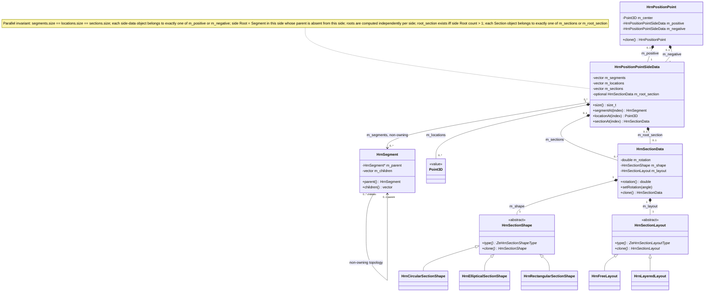

# 位置点分侧截面数据结构设计

## 1. 文档状态

- 状态：待评审
- 日期：2026-11-13
- 范围：仅使用普通 C++ Class 讨论单个 Position Point 正、负两侧的截面数据结构，以及保持三份平行容器一致所需的运行时契约
- 不包含：面积计算、排布算法细节、沿路径姿态连续性和三维实体生成

## 2. 设计意图

位置点两侧分别通过 Segment 容器和 Location 容器记录穿过位置点的 Segment 及其截面计算结果：

```cpp
std::vector<HrnSegment*> m_segments;
std::vector<Point3D> m_locations;
```

正、负两侧各有一组独立容器。Segment 容器不只是截面成员集合，还提供线束拓扑身份。两侧分别包含本侧全部层级的 Segment，Segment 的父子层级由 `HrnSegment` 对象表达。

本设计在不改变上述职责的前提下，为两侧分别增加与 Segment 容器同序的 Section 数据容器，使每个“Position Point × Side × Segment”具有独立、可扩展的截面定义。正、负两侧即使存在既有 Segment 对应关系，也允许使用不同的截面形状、尺寸和旋转。

当一侧存在多个 Root Segment 时，还需要一个不对应具体 Segment、由 Position Point 直接持有的可编辑顶层 Section，作为多个 Root Segment 的共同排布边界。

## 3. 现有设计约束

### 3.1 Position Point 是截面位置载体

Position Point 保存公共中心位置，并区分正、负方向。每侧的 Location 容器保存截面计算完成后各 Segment 的三维中心坐标。

### 3.2 Segment 是拓扑和层级身份

Segment 容器及 Segment 自身的父子关系是线束拓扑的权威数据。Section 数据不得：

- 替换正、负两侧的 Segment 拓扑职责；
- 在 Section 条目中重复保存 Segment 引用；
- 另建一棵与 Segment 父子关系重复的 Section 树；
- 通过正负容器下标推断两侧 Segment 的对应关系。

### 3.3 两侧完全独立

正负两侧的 Segment 数量、层级和截面定义都可能不同。有效的不变量仅存在于单侧内部：

```text
pos_seg[i] <-> pos_loc[i] <-> pos_section[i]
neg_seg[j] <-> neg_loc[j] <-> neg_section[j]
```

不要求：

```text
size(pos_seg) == size(neg_seg)
pos_seg[i] 与 neg_seg[i] 存在任何关系
pos_section[i] 与 neg_section[i] 具有相同形状或尺寸
```

两侧 Segment 之间既有的一对一、一对多或多对一关系不属于本设计范围。该关系可以在上层用于约束有关 Segment 在 Position Point 处的三维位置一致，但不能改变分侧 Section 数据的独立所有权。

## 4. 方案比较

### 4.1 方案 A：继续增加多个基本类型平行容器

为形状类型、半径、宽度、高度和旋转分别增加容器。

优点：

- 与现有容器形式表面上接近；
- 对简单圆形截面实现成本低。

缺点：

- 容器数量随参数增加而膨胀；
- 不同形状的大量字段无效；
- 所有容器都必须保持等长同序，极易产生错位；
- 无法自然支持不同形状的参数扩展。

结论：不采用。

### 4.2 方案 B：统一固定结构或联合体

用形状枚举配合固定字段或联合体保存不同形状参数。

优点：

- 单个 Section 条目可以包含完整数据；
- 常见字段访问直接。

缺点：

- 固定字段会产生无效参数组合；
- 每增加一种形状或扩展形状参数，都需要修改公共结构。

结论：不采用。

### 4.3 方案 C：Section 组合多态 Shape 与 Layout

Section 保存公共数据，并组合一个多态 Shape 和一个多态 Layout。不同 Shape 派生类保存各自可扩展的边界参数；不同 Layout 派生类表达自由排布、分层排布等策略。Position Point 两侧各增加一个与原 Segment 容器同序的 Section 对象容器。

优点：

- 各 Shape 只保存自身有效参数；
- 形状参数可独立演进；
- 新增形状不改变 Position Point 的字段布局；
- 外边界与排布策略解耦，避免产生“矩形分层 Section”“椭圆分层 Section”等组合型派生类；
- Section 公共属性只定义一次；
- 不重复 Segment 拓扑。

代价：

- 普通 C++ 对象需要明确 Shape、Layout 的所有权和深拷贝；
- 容器增删必须与 Segment、Location 容器原子同步；
- 形状或排布类型切换需要替换对应策略对象。

结论：采用。

## 5. 总体数据结构

以下代码只表达普通 C++ Class 的数据职责和对象关系。

```cpp
class HrnSegment
{
public:
    const HrnSegment* parent() const;
    const std::vector<HrnSegment*>& children() const;

private:
    // Segment 拓扑由外部业务对象管理，这里均为非拥有引用
    HrnSegment* m_parent;
    std::vector<HrnSegment*> m_children;
};

class HrnSectionData;

class HrnPositionPointSideData
{
public:
    size_t size() const;
    const HrnSegment& segmentAt(size_t index) const;
    const Point3D& locationAt(size_t index) const;
    const HrnSectionData& sectionAt(size_t index) const;

private:
    // 三个容器必须等长同序
    std::vector<HrnSegment*> m_segments; // 非拥有引用
    std::vector<Point3D> m_locations;
    std::vector<std::unique_ptr<HrnSectionData>> m_sections;

    // 仅在本侧存在多个 Root Segment 时非空
    std::unique_ptr<HrnSectionData> m_root_section;
};

class HrnPositionPoint
{
public:
    std::unique_ptr<HrnPositionPoint> clone() const;

private:
    Point3D m_center;
    HrnPositionPointSideData m_positive;
    HrnPositionPointSideData m_negative;
};
```

### 5.1 Segment Section 容器

`HrnPositionPointSideData` 的三个容器分别记录本侧全部 Segment 引用、计算后的 Location 和对应的 Section 对象。

```text
segments[k] -> Segment 身份与拓扑
locations[k] -> 该 Segment 在本侧计算后的三维中心坐标
sections[k] -> 该 Segment 在本侧的形状、尺寸和旋转
```

负侧规则相同，但容器长度和下标空间与正侧无关。

由于每侧的 Segment 容器已包含本侧全部层级的 Segment，Section 条目不需要递归持有子 Section。需要遍历截面层级时：

1. 从 Segment 父子关系获得层级；
2. 通过本侧 Segment 容器定位对应下标；
3. 使用同下标访问 Location 和 Section。

### 5.2 多 Root 顶层 Section

当某侧只有一个 Root Segment 时，该 Root Segment 对应的 Section 同时作为本侧有效根截面，不额外创建顶层 Section。

当某侧有多个 Root Segment 时，由对应的 `HrnPositionPointSideData` 独占持有一个可编辑顶层 Section：

```text
Position Point 某侧顶层 Section
├── Root Segment A 对应的 Section
├── Root Segment B 对应的 Section
└── Root Segment C 对应的 Section
```

该顶层 Section：

- 不对应 Segment；
- 不进入 Segment 拓扑；
- 不保存 Segment 引用；
- 中心固定使用 Position Point 已有的公共中心位置；
- 形状、尺寸和旋转可以编辑；
- 与 Segment Section 使用相同的 `HrnSectionData` 类型，由 `m_root_section` 独占持有；
- 正负两侧分别判断是否需要，互不影响。

当某侧不需要额外顶层 Section 时，`m_root_section` 必须为空，不允许保留一个仍参与访问的游离 Root Section 对象。

建议由统一访问接口隐藏单 Root 与多 Root 的差异：

```cpp
const HrnSectionData* getEffectiveRootSection(ZeHrnSide side) const;
```

- 单 Root：返回唯一 Root Segment 对应的 Section；
- 多 Root：返回 Position Point 直接持有的侧级顶层 Section；
- 无 Root：返回空或明确的无截面状态。

### 5.3 UML 类图

下图只表达本设计中的普通 Class 关系。`HrnPositionPointSideData` 仍分别保存 Segment、Location 和 Section 三个平行容器，没有合并为条目对象。为保持类图可读性，成员中的指针、引用和模板容器细节使用概念类型简写；具体 C++ 类型和所有权以正文类草图和关系线为准，类图不重新定义数据结构。



关系说明：

- `*--` 表示值成员或独占所有权；
- `-->` 表示非拥有引用，`HrnPositionPointSideData` 和 `HrnSegment` 不负责销毁所引用的 Segment；
- `m_sections` 与 `m_root_section` 分别拥有不同的 `HrnSectionData` 对象；
- Segment 自关联表达父子拓扑，Section 层级通过该拓扑与本侧 `m_segments` 共同派生。

## 6. Section、Shape 与 Layout

### 6.1 Section 公共数据

Section 统一保存所有截面的公共数据，并通过组合持有 Shape 与 Layout。Section 不保存 Segment 引用和三维中心位置。

```cpp
class HrnSectionShape;
class HrnSectionLayout;

class HrnSectionData
{
public:
    double rotation() const;
    void setRotation(double angle);

    const HrnSectionShape& shape() const;
    const HrnSectionLayout& layout() const;

    std::unique_ptr<HrnSectionData> clone() const;

private:
    double m_rotation;
    std::unique_ptr<HrnSectionShape> m_shape;
    std::unique_ptr<HrnSectionLayout> m_layout;
};
```

首版不预留没有明确语义的 `flags` 字段。

`m_rotation` 与 Location 不重复：Location 保存该 Segment Section 在单个 Position Point 处计算后的中心坐标，Rotation 决定截面形状在该点截面平面内的方向。圆形截面也保留旋转，以避免切换为非圆形后方向信息丢失。

旋转角度相对于 Position Point 处的现有截面基准坐标系。正负两侧以及每个 Section 分别保存旋转角，可以独立设置。Section 不保存父子相对 `x、y`，也不保存三维 H/V。

任一 Section 的形状、尺寸、旋转或 Layout 参数发生变化时，先在事务临时状态中修改参数，再以 Position Point、两侧 Segment 拓扑和临时状态中的全部 Section 参数为完整输入，重新计算该 Position Point 正、负两侧所有 Segment Section 的位置，不基于旧 Location 或父子相对位置做增量刚性变换。只有两侧计算全部成功后，Section 参数和两侧 `m_locations` 才能作为同一事务原子提交；任一侧计算失败时，Section 参数和两侧 Location 容器均保持修改前状态。

这里的 Location 虽采用现有三维点格式保存，但本阶段只保证单个 Position Point 截面平面内的排布结果正确，不保证沿路径的参考法向连续性、三维截面形态、扫掠或 Loft 结果。

### 6.2 Shape 多态层次

```cpp
class HrnSectionShape
{
public:
    virtual ~HrnSectionShape() = default;
    virtual ZeHrnSectionShapeType type() const = 0;
    virtual std::unique_ptr<HrnSectionShape> clone() const = 0;
};

class HrnCircularSectionShape final : public HrnSectionShape
{
public:
    ZeHrnSectionShapeType type() const override;
    std::unique_ptr<HrnSectionShape> clone() const override;

private:
    double m_radius;
};

class HrnEllipticalSectionShape final : public HrnSectionShape
{
public:
    ZeHrnSectionShapeType type() const override;
    std::unique_ptr<HrnSectionShape> clone() const override;

private:
    double m_major_radius;
    double m_minor_radius;
};

class HrnRectangularSectionShape final : public HrnSectionShape
{
public:
    ZeHrnSectionShapeType type() const override;
    std::unique_ptr<HrnSectionShape> clone() const override;

private:
    double m_width;
    double m_height;
};
```

首版参数口径为：

- 圆形：半径；
- 椭圆：长半轴、短半轴；
- 矩形：完整宽度、完整高度；
- 所有长度使用当前模型长度单位，并且必须大于建模容差；
- 矩形首版不包含圆角参数。

Shape 派生类负责：

- 自身参数的合法性；
- 自身数据的深拷贝；
- 后续统一几何接口所需的形状行为。

后续可在不改变 `HrnSectionData` 和 Position Point 结构的情况下，扩展现有 Shape 参数或增加新的 Shape 派生类。

### 6.3 Layout 多态层次

层级排布不是新的边界形状，而是一种可与不同外边界组合的排布策略。

```cpp
class HrnSectionLayout
{
public:
    virtual ~HrnSectionLayout() = default;
    virtual ZeHrnSectionLayoutType type() const = 0;
    virtual std::unique_ptr<HrnSectionLayout> clone() const = 0;
};

class HrnFreeLayout final : public HrnSectionLayout
{
public:
    ZeHrnSectionLayoutType type() const override;
    std::unique_ptr<HrnSectionLayout> clone() const override;
};

enum class HrnHorizontalAlignment
{
    Left,
    Center,
    Right
};

class HrnLayeredLayout final : public HrnSectionLayout
{
public:
    ZeHrnSectionLayoutType type() const override;
    std::unique_ptr<HrnSectionLayout> clone() const override;

private:
    HrnHorizontalAlignment m_alignment;
};
```

`HrnLayeredLayout` 用于类似排线对象的逐层排布，并支持左对齐、居中对齐和右对齐。对齐方向相对于 Section 旋转后的局部水平轴解释，不使用全局屏幕方向。

本阶段只保留该类型及对齐方式，不设计分层方向、层间距、成员间距、自动换层、显式层号和层内顺序等布局细节。

### 6.4 不应进入 Section 的数据

- Segment 引用：由同下标的 Segment 容器提供；
- Segment 父子关系：由 Segment 拓扑提供；
- 三维中心坐标：由同下标的 Location 容器提供；
- 正负侧对应关系：沿用现有关系设计；
- 面积和占用率：本阶段不设计；
- 排布算法临时状态：本阶段不进入核心结构。

## 7. 结构不变量

### 7.1 单侧容器一致性

对每个 Position Point，必须始终满足：

```cpp
positive.segments().size() == positive.locations().size()
positive.segments().size() == positive.sections().size()

negative.segments().size() == negative.locations().size()
negative.segments().size() == negative.sections().size()
```

不得要求正负两侧大小相同。

同一侧 Segment 容器中的每个 Segment 引用必须非空且唯一。正、负两侧是独立集合，同一个 Segment 对象可以分别出现在两侧。

### 7.2 原子修改

以下结构操作必须通过 Position Point 的统一接口完成，不允许调用方分别修改三个容器：

- 增加某侧 Segment；
- 删除某侧 Segment；
- 调整某侧 Segment 的容器顺序；
- 将 Segment 从一侧移至另一侧；
- 复制 Position Point；

一次操作必须同时更新本侧 Segment、Location 和 Section 容器。任一步骤失败时，三个容器均应保持操作前状态。

替换 Section 的 Shape、Layout 或修改其参数不改变容器结构，但必须通过 Position Point 的受控接口在临时状态中执行。按照 6.1 的规则完成正、负两侧全部 Location 重新计算后，参数和 Location 作为同一事务提交；计算失败时参数及 Location 全部回滚。删除单独一个 Section 等价于删除对应的完整 Segment/Location/Section 条目，不允许留下空 Section 占位破坏容器语义。

### 7.3 Root 判定

Root Segment 由既有 Segment 拓扑和当前侧 Segment 容器共同判定，而不是由容器顺序或 Section 数据标记。

对于某一侧 `S`，若 Segment `x` 位于该侧 Segment 容器中，并且 `x` 的父 Segment 不在该侧 Segment 容器中，则 `x` 是侧 `S` 的 Root Segment。父 Segment 不存在与父 Segment 存在但只位于另一侧，在本侧 Root 判定中具有相同含义。

正、负两侧必须分别计算 Root。同一个 Segment 可以在一侧是 Root Segment，在另一侧不是 Root Segment，禁止复用另一侧的 Root 计算结果。

正负两侧分别计算 Root 数量：

- 0 个：无有效根截面；
- 1 个：使用该 Segment 的 Section；
- 多个：使用对应侧的可编辑顶层 Section。

顶层 Section 的存在不能反向改变 Segment Root 判定。

### 7.4 深拷贝与所有权

每个 `m_sections` 条目通过 `std::unique_ptr` 独占一个 Section 对象，Section 独占其 Shape 和 Layout。每侧的 `m_root_section` 同样独占其对象。即使正负两侧 Segment 存在对应关系，也不得共享同一 Section、Shape 或 Layout 对象实例，因为两侧允许拥有不同形状、尺寸、旋转和排布方式。

Position Point 复制时，Segment 引用继续指向原有 Segment 对象，Location 按值复制，Section 及其 Shape、Layout 通过 `clone()` 深拷贝：

- 正侧全部 Section；
- 负侧全部 Section；
- 正侧可选顶层 Section；
- 负侧可选顶层 Section。

复制完成后，新 Position Point 不得继续引用源 Position Point 拥有的 Section、Shape 或 Layout 对象。

### 7.5 运行时合法性检查

Segment 容器是单侧条目身份和顺序的权威数据。Position Point 在构造完成后以及每次修改事务提交前，都必须检查：

1. 正、负两侧的每个 Segment 引用均非空；
2. 同一侧不存在重复 Segment 引用；
3. 每侧 Segment、Location、Section 三个容器长度一致；
4. 每个 Section 所有权指针非空，且对应 Section 的 Shape、Layout 和参数通过合法性检查；
5. 接纳对象所有权前以及事务提交前，检查两侧 `m_sections` 和两个可选 `m_root_section` 中所有 Section 对象身份互不重复，并检查各 Section 独占的 Shape、Layout 对象身份互不重复；发现共享对象时拒绝接纳或提交；
6. 本侧 Root Segment 数量大于一个时 `m_root_section` 非空，否则 `m_root_section` 为空。

发现不合法状态时，不允许提交当前事务。Location 作为计算结果出现无效坐标时，不保留部分旧结果，必须重新计算该 Position Point 正、负两侧全部 Location；重新计算失败则保持修改前状态。

当三个容器长度相同但 Section 顺序已经错位时，仅凭 Section 参数无法自动识别这种错位。该风险必须通过封装容器、统一修改入口和原子重排预防。

## 8. 数据访问边界

`HrnPositionPoint` 是三份平行容器的唯一修改入口。管理器及其他调用方不得分别修改 Segment、Location 或 Section 容器。建议提供基于 Side 和容器下标的集中访问接口：

```cpp
size_t sectionCount(ZeHrnSide side) const;
const HrnSegment& segmentAt(ZeHrnSide side, size_t index) const;
const Point3D& locationAt(ZeHrnSide side, size_t index) const;
const HrnSectionData& sectionAt(ZeHrnSide side, size_t index) const;

int appendSectionItem(
    ZeHrnSide side,
    HrnSegment& segment,
    std::unique_ptr<HrnSectionData> section);

int removeSectionItem(ZeHrnSide side, size_t index);

int replaceSectionData(
    ZeHrnSide side,
    size_t index,
    std::unique_ptr<HrnSectionData> section);

bool validateSectionData(HrnSectionValidationResult& result) const;
```

`appendSectionItem`、`removeSectionItem` 和 `replaceSectionData` 均先修改事务临时状态，再由 Position Point 内部触发整点 Location 重新计算；调用方不能提交或直接改写单个 Location，也不能通过可变 Section 引用绕过校验和原子提交。参数或结构修改与两侧 Location 的提交、回滚是同一个事务边界。

接口必须以单侧下标工作，不提供把正侧下标直接转换为负侧下标的功能。需要处理两侧 Segment 对应关系的调用方，应先通过既有对应关系获得目标 Segment，再在目标侧按 Segment 身份定位下标。

## 9. 与 CATIA V5 调研的关系

CATIA V5 的参考价值主要在于：

- 同一路径不同位置可以具有不同 Profile；
- 非圆截面具有独立方向；
- Profile 的形状参数需要可扩展；
- 截面数据不能简单等同于 Wire 直径。

本设计不直接复刻 CATIA 的 Profile Management：

- CATIA 调研没有证明其原生支持父子嵌套截面树，因此不能把 CATIA Profile 作为本项目层级关系的权威来源；
- 本项目的层级由既有 Segment 拓扑提供；
- CATIA 的 Multi-profile 是沿路径的多个截面，不等同于 Position Point 正负两侧的独立 Segment Section 集合；
- 本阶段不引入 CATIA 的面积联动和 Loft 过渡设计。

## 10. 本阶段明确不解决的问题

- 正负 Segment 对应关系的数据结构；
- 一对一、一对多、多对一关系的建立和编辑；
- 两侧有关 Segment 三维位置一致性的求解方式；
- 截面积、占用面积和面积约束；
- 截面内部自动排布算法；
- 单 Root 与多 Root 状态变化时顶层 Section 的创建、保留或清理策略；
- 任意封闭轮廓的具体参数结构；
- Layered Layout 的分层和排序细节；
- 沿路径参考法向退化、翻转及曲线更新时的旋转连续性；
- Section 到三维扫掠、Loft 或保护层几何的转换。

这些问题不应通过向核心数据结构加入重复身份或弱类型字段来提前规避，应在后续专项设计中基于本结构继续讨论。

## 11. 已确定的技术决策

1. `HrnPositionPoint` 分别持有正、负两侧的 `HrnPositionPointSideData`。
2. 每侧保留 Segment、Location、Section 三个独立的平行容器。
3. Section 容器与本侧 Segment、Location 容器等长同序。
4. Section 条目不保存 Segment 引用。
5. 正负容器长度和下标没有对应关系。
6. 同一逻辑线在两侧可以具有不同截面形状和尺寸。
7. Section 组合多态 Shape 和多态 Layout，外边界与排布策略解耦。
8. Segment Section 的三维中心位置继续由本侧 Location 容器保存。
9. 多 Root 场景使用 `HrnPositionPointSideData` 独占持有的可编辑顶层 Section。
10. 顶层 Section 固定以 Position Point 的公共中心位置为中心。
11. 单 Root 场景直接使用 Root Segment 对应的 Section。
12. Section 对外暴露相对于单个 Position Point 截面基准坐标系的旋转角度，不保存父子相对 `x、y` 或三维 H/V。
13. 任一 Section 参数变化时，重新计算该 Position Point 正、负两侧全部 Segment Section 位置，不基于旧 Location 做增量刚性变换。
14. 首版 Shape 为圆形、椭圆形和矩形，参数分别采用半径、长短半轴、完整宽高。
15. 首版提供 Free Layout 和 Layered Layout；后者具有左、中、右对齐类型，但暂不设计布局细节。
16. 首版不保留无明确语义的通用 flags。
17. `HrnPositionPoint` 是三份平行容器的唯一原子修改入口；同侧 Segment 引用必须非空且唯一。
18. 构造完成后和事务提交前校验 Segment 引用、三容器长度、Section 所有权和 Root Section 状态。
19. Section 不保存 Segment 引用，因此等长但顺序错位的数据无法由 Section 参数自动识别，必须依靠封装容器和统一修改入口预防。
20. 本阶段暂不设计面积、沿路径姿态连续性和三维形态。

## 12. 待评审重点

评审时建议重点确认：

- Section、Shape、Layout 的组合边界是否符合后续扩展方向；
- 旋转角使用的现有截面基准坐标系能否满足稳定性要求；
- 多 Root 顶层 Section 与单 Root Segment Section 的统一访问语义是否合理；
- Root Segment 数量变化时，可编辑顶层 Section 的生命周期策略；
- Layered Layout 后续应采用自动分层还是显式分层。

